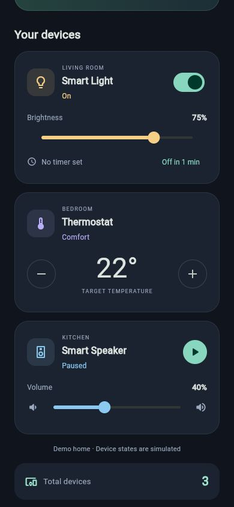

# Smart Home Controller

## Group members

- Ömer Kağan Kaplan
- Emre Kechagia

A Flutter app for **BIM493 Mobile Programming I - Assignment 2**.
Three simulated smart devices, an English dark dashboard, and interactive controls.
No real device connection, backend, account, or API key is required. State is kept in memory and resets when the app restarts.



## Run

Built and tested with Flutter 3.41.7 / Dart 3.11.5.

```sh
flutter pub get
flutter run
```

Choose an Android emulator/device or a supported browser. For a web build:

```sh
flutter build web
```

Android builds need a configured Android SDK, accepted SDK licenses, and a compatible JDK. This project includes Android and web platform sources.

## Controls

- **Living room / Smart Light:** toggle power, change brightness from 1-100%, and schedule auto-off after one minute. The timer can be cancelled; setting a new timer replaces the previous timer.
- **Bedroom / Thermostat:** adjust the target temperature from 16-30 degrees Celsius. The simulated mode is Cooling below 22, Comfort at 22, and Heating above 22.
- **Kitchen / Smart Speaker:** toggle play/pause and change volume from 0-100%. Playback is a simulated status; the app does not play an audio file.
- The fixed bottom bar displays the total number of constructed devices from `SmartDevice.totalDevices`.

## Assignment requirements

| Requirement | Implementation |
| --- | --- |
| Base class and three subclasses | `SmartDevice`, `SmartLight`, `Thermostat`, `SmartSpeaker` in `lib/models/smart_device.dart` |
| Objects | One instance of each subtype, created once in `HomePage.initState()` |
| Default / unnamed constructor | `SmartLight(...)` and `SmartSpeaker(...)` |
| Named constructor | `Thermostat.comfort(...)`, delegating to `this(...)` |
| Inheritance | All three types extend `SmartDevice` |
| Abstraction | Abstract `SmartDevice` declares `getStatus()` and `performAction()` |
| Interface | `Connectable` declares `connect()` and `disconnect()`; `SmartDevice` implements it and subclasses inherit the implementation |
| Mixin | `Schedulable` supplies actual timer behavior to `SmartLight` |
| `static` | Shared device creation counter, exposed through a static getter |
| `super` | Constructor parameters pass name and room to the base constructor |
| `this` | Initializing formals and the named redirecting constructor |
| Device cards and interactions | `DeviceCard` and `HomePage` in `lib/main.dart` |

The static counter records **created objects**, not currently active connections. Widget rebuilds do not create more devices. Hot restart resets the Dart process state.

## Validation

```sh
flutter analyze
flutter test
```

Tests cover constructor counting, inherited connection behavior, device state transitions, value limits, timer execution/replacement/cancellation, UI actions, and scrolling on a 320-pixel-wide screen.

## Project map

- `lib/main.dart`: app theme, dashboard, reusable device card, and user interactions.
- `lib/models/smart_device.dart`: device models, interface, and scheduling mixin.
- `test/device_test.dart`: behavior tests for device models.
- `test/widget_test.dart`: interactive widget and narrow-screen tests.
- `android/`, `web/`: platform runner sources.

See `docs/OOP_NOTES_TR.md` for a Turkish explanation of the design.

Local verification: static analysis clean, 7 tests passed, release web build succeeded, and browser controls checked at mobile size. Android debug APK compilation, installation, and launch on the Android emulator were also verified.


